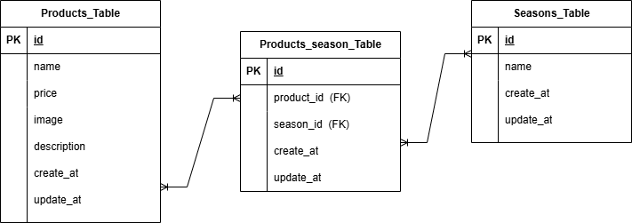

# Mogitate（もぎたて）

## アプリケーション概要

Mogitateは、果物のスムージー商品情報を管理するWebアプリケーションです。

商品一覧の閲覧、商品名による検索、価格順の並び替え、商品の登録・編集・削除などの機能を備えています。

Webアプリケーション開発の学習過程で、模擬案件として制作しました。指定されたデザイン・機能要件に基づき、Laravelを使用して商品管理機能を実装しました。

## 主な機能

### 商品一覧・検索機能
- 商品一覧表示
- 商品名による部分一致検索
- 価格の昇順・降順での並び替え
- 商品名検索と価格順の並び替えの同時実行
- ページネーション（6件ごと）

### 商品管理機能
- 商品の新規登録
- 商品詳細情報の表示
- 商品情報の編集
- 商品の削除
- 商品画像のアップロード
- 季節の複数選択

### バリデーション機能
LaravelのFormRequestを使用し、商品登録・編集時の入力内容を検証しています。

- 必須項目の入力チェック
- 価格の数値・範囲チェック（0〜10,000円）
- 画像形式のチェック（PNG・JPEG）
- 商品説明の文字数制限（120文字以内）

## 使用技術

| 技術 | バージョン |
|---|---|
| PHP | 8.1 |
| Laravel | 8.83.29 |
| MySQL | 8.0.26 |
| nginx | 1.21.1 |
| Docker | Docker Compose |

## データベース設計

### ER図



## 環境構築

### 1. リポジトリのクローン

```bash
git clone git@github.com:mii4573/mogitate.git
cd mogitate
```

### 2. Dockerコンテナの起動

```bash
docker-compose up -d --build
```

### 3. PHPコンテナに入る

```bash
docker-compose exec php bash
```

### 4. Laravelのセットアップ

```bash
composer install
cp .env.example .env
php artisan key:generate
```

`.env`ファイルのデータベース接続情報を、Docker環境に合わせて設定してください。

### 5. データベースの作成

```bash
php artisan migrate
php artisan db:seed
```

## 開発環境

- 商品一覧画面：localhost
- phpMyAdmin：localhost:8080

※ローカル開発環境で動作するアプリケーションです。

## 制作について

本アプリケーションは、指定されたデザイン・機能要件に基づいて制作した模擬案件です。

Laravelを使用したCRUD処理、検索・並び替え機能、FormRequestによるバリデーション、画像アップロードなど、Webアプリケーション開発の基本的な機能を実装しました。